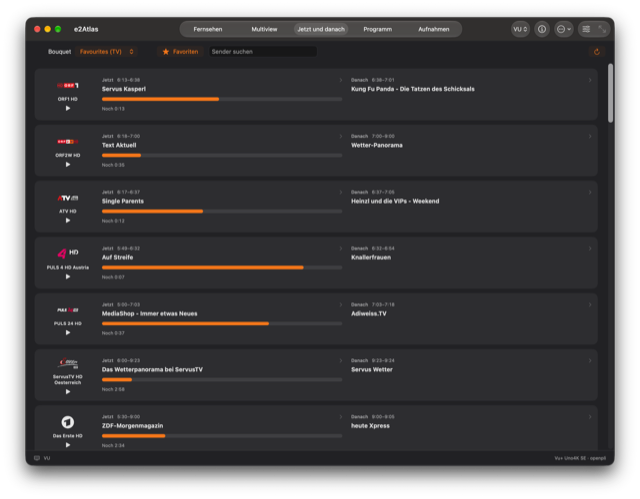
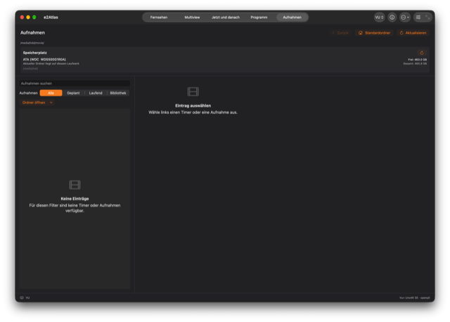

<p align="center"></p>
<p align="center"><strong>English</strong> · <a href="README.de.md">Deutsch</a></p>

# e2Atlas — Enigma2 TV player for macOS

e2Atlas brings live TV from your Enigma2 receiver to your Mac through OpenWebif. Watch a channel, follow up to four streams in multiview, or browse the electronic program guide while keeping the picture in view. The native SwiftUI interface uses Liquid Glass controls and follows your Mac's light or dark appearance.

**Requires an Apple Silicon Mac (M1 or later), macOS 26 or later, and an Enigma2 receiver with accessible OpenWebif and streaming services.** The current release is **0.5.0-beta**. Intel Macs are not supported.

[Download the beta](https://github.com/Schrotty74/e2Atlas/releases/tag/v0.5.0-beta) · [Changelog](CHANGELOG.md) · [Security policy](SECURITY.md)

## Features

- Watch live TV from an Enigma2 receiver, with bouquets, channel search and receiver-provided logos.
- Follow up to four channels in multiview and save layouts with their audio settings.
- Scroll and search seven days of EPG, or use the compact Now and Next view, with cached listings, recording markers and configurable automatic updates.
- Schedule receiver-side EPGRefresh with a time window, bouquet selection and channel dwell time.
- Schedule and manage receiver recordings from the guide, with conflict details and alternative broadcasts.
- Create AutoTimer rules for recurring title matches and preview matches in the loaded EPG.
- Browse and play receiver recordings, resume saved positions and view receiver storage space.
- Record the original TV stream locally as a `.ts` file, with folder and duration options and a low-space stop.
- Set programme reminders that macOS can deliver with the app closed, and open programme details from the notification.
- Save favourite channels per receiver and access them independently of the selected bouquet. Export and import settings backups with an import preview.

See the complete [feature overview](FEATURES.md) for playback controls, themes, languages, receiver settings and further details.

## Custom themes

[Create your own theme](Documentation/Themes/README.md) with the [JSON template](Documentation/Themes/theme-template.json?raw=true). The guide covers light and dark palettes, gradients, multiple theme files and the template creation button. Valid custom themes can also be included in settings backups.

## Screenshots

These screenshots show the German interface of e2Atlas 1.0.0-final. Click a preview to open the full-resolution image. Some controls differ from Beta 0.5.0.

<table>
<tr>
<td align="center"><a href="Documentation/Screenshots/full/live-tv.png?raw=true"></a><br>Live TV</td>
<td align="center"><a href="Documentation/Screenshots/full/multiview.png?raw=true"></a><br>Multiview</td>
</tr>
<tr>
<td align="center"><a href="Documentation/Screenshots/full/now-next.png?raw=true"></a><br>Now and Next</td>
<td align="center"><a href="Documentation/Screenshots/full/programme-guide.png?raw=true"></a><br>Programme guide</td>
</tr>
<tr>
<td colspan="2" align="center"><a href="Documentation/Screenshots/full/recordings.png?raw=true"></a><br>Recordings and storage</td>
</tr>
</table>

## Install and open the beta

Download the DMG or ZIP from the [official GitHub release](https://github.com/Schrotty74/e2Atlas/releases/tag/v0.5.0-beta). Open the DMG and drag **e2Atlas Beta** to **Applications**, or extract the ZIP and move the app there.

### First launch: Gatekeeper

e2Atlas Beta is ad-hoc signed. It has no Apple Developer ID certificate and is not notarized, so macOS may block the first launch. If you trust the official download:

1. Try to open **e2Atlas Beta** once.
2. Open **System Settings → Privacy & Security** and scroll to **Security**.
3. Click **Open Anyway** for e2Atlas Beta.
4. Confirm with **Open** and authenticate if macOS asks.

This adds an exception for this app. [Apple's Gatekeeper instructions](https://support.apple.com/en-us/102445) explain the process. If macOS reports malware or a damaged app, stop and check the download rather than overriding that warning.

## Connect your receiver

On first launch, enter a receiver name and its IP address or hostname. Leave the username and password empty if the receiver does not require authentication. A protected receiver may still require valid credentials to connect or stream. Choose a bouquet and channel after connecting. Further receivers can be added in Settings. Dev and Beta keep separate settings, theme folders and caches. To transfer a Dev profile, export a settings backup and import it in Beta, or enter the profile again. Passwords are excluded from backups.

Use your receiver on a trusted local network. Plain HTTP connections do not encrypt the password or TV stream. Receiver image compatibility depends on the OpenWebif and streaming services it provides.

## Beta status

Local recording saves the receiver’s original stream to a `.ts` file. Receiver recording timers are managed separately; unknown or special timer types remain read-only. Scheduling was confirmed on a real receiver in Dev; actual timer execution and broader image compatibility remain unconfirmed. Keychain permission prompts after rebuilding remain under investigation, and protected receivers may require access to saved credentials. Playback checks and automated tests ran on macOS 27; macOS 26 and further receiver images still need testing. VideoToolbox is requested when supported, but hardware decoding and CPU impact have not been measured. See the [changelog](CHANGELOG.md) for release details.

<details>
<summary>Build e2Atlas from source</summary>

Install Xcode 27 and select its command-line tools, then run:

```sh
git clone --branch beta https://github.com/Schrotty74/e2Atlas.git
cd e2Atlas
./Scripts/build_beta_app.sh
```

The output is `Build/Beta/e2Atlas Beta.app`. Build scripts resolve the project directory from their own location, so the checkout can be stored anywhere, including a path with spaces. The build downloads VLCKit 3.7.3 from VideoLAN and verifies its SHA-256 checksum. No personal signing certificate is required.

Open `e2Atlas.xcodeproj` for development. `Scripts/generate-project.py` regenerates the project, and `Scripts/test.sh` runs the tests through Xcode. The SwiftPM manifest describes the modules; Xcode is the supported test runner because of VLCKit runtime loading.

All build entry points live in `Scripts/`. Beta builds require a checkout on `beta`; Final builds require `main`. Dev stays local. `Scripts/package-beta.sh 0.5.0-beta` packages a clean, committed Beta checkout as ZIP and DMG with checksums. Build and packaging scripts do not publish releases.

</details>

## License

e2Atlas uses the [GNU GPL v3 license](LICENSE). VLCKit is a replaceable dynamic framework under LGPL-2.1-or-later; its license and source links are included in `Resources` and in the app.
