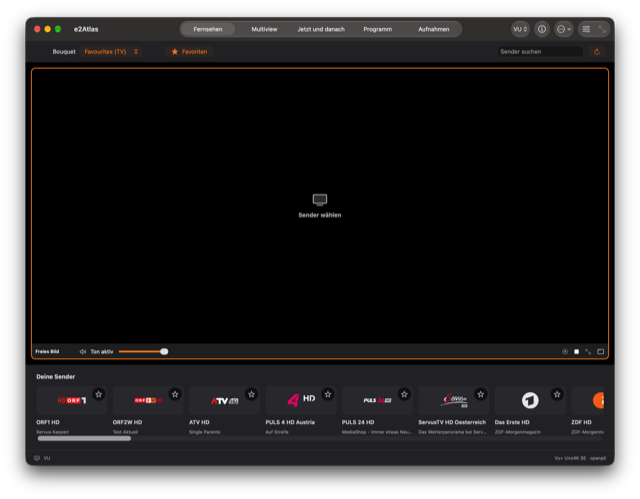
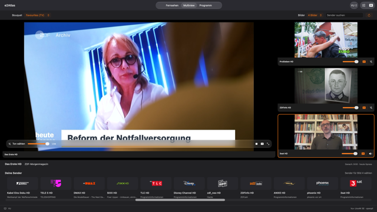
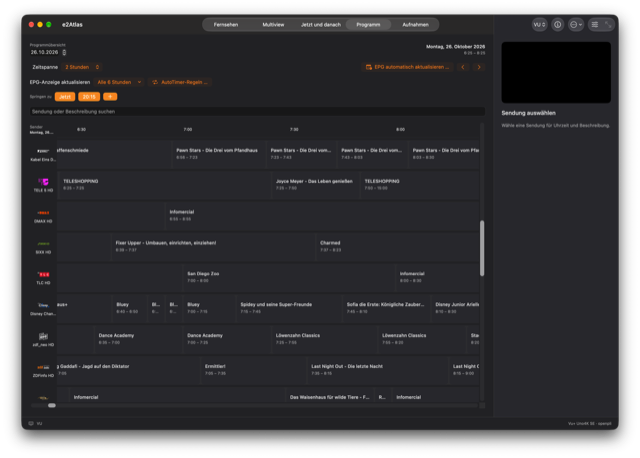
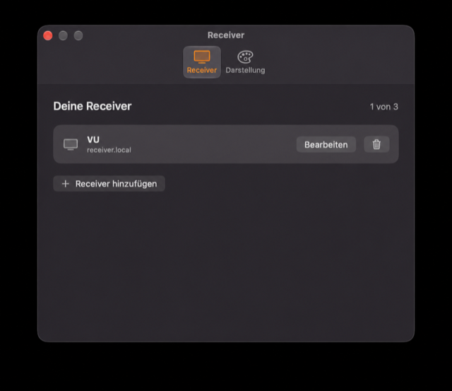
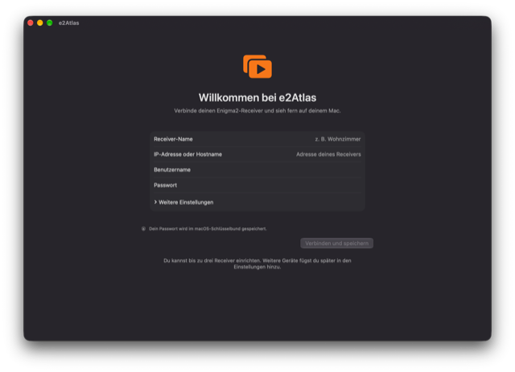

<p align="center"></p>
<p align="center"><strong>English</strong> · <a href="README.de.md">Deutsch</a></p>

# e2Atlas — Enigma2 TV player for macOS

e2Atlas brings live TV from your Enigma2 receiver to your Mac through OpenWebif. Watch a channel, follow up to four streams in multiview, or browse the electronic program guide while keeping the picture in view. The native SwiftUI interface follows your Mac's light or dark appearance.

**Requires an Apple Silicon Mac (M1 or later), macOS 26 or later, and an Enigma2 receiver with accessible OpenWebif and streaming services.** The current release is **0.2.0-beta**. Intel Macs are not supported.

[Download the beta](https://github.com/Schrotty74/e2Atlas/releases/tag/v0.2.0-beta) · [Changelog](CHANGELOG.md) · [Security policy](SECURITY.md)

## Features

- Live TV with bouquets, channel search and channel logos loaded from the receiver.
- Multiview with two, three or four pictures and one selected audio source. Swap a small picture with the main picture while keeping each player's audio and volume settings.
- Mute and volume controls, plus video-only fullscreen with Escape or double-click to return.
- Electronic program guide (EPG) with 2-, 4- and 6-hour windows, a 20:15 shortcut and custom time shortcuts.
- Receiver information for reported hardware and software details. Tuner use is shown when confirmed; streams without a usable tuner assignment are counted separately, so total tuner occupancy may remain unknown, including on FBC receivers.
- Record the original receiver stream to a local `.ts` file from the player or a multiview tile. Stop the recording in the app and reveal the file in Finder.
- Up to three saved receivers. Username and password are optional for receivers that allow unauthenticated access; passwords are stored in the macOS Keychain.
- A System theme, plus Ocean, Ivory and Bronze themes with light and dark palettes. Choose automatic, light or dark appearance. Create a custom JSON theme from the template button in Appearance settings.
- About tab links to the developer's homepage and the GitHub repository.
- Playback requests Apple's VideoToolbox decoder when supported; the playback library can fall back to software decoding. Hardware use and CPU impact have not been measured.

## Custom themes

[Create your own theme](Documentation/Themes/README.md) with the [JSON template](Documentation/Themes/theme-template.json?raw=true). The guide covers light and dark palettes, gradients, multiple theme files and the template creation button.

## Screenshots

Click a preview to open the full-resolution image. The screenshots show the current German interface; the receiver address has been anonymized.

<table>
<tr>
<td align="center"><a href="Documentation/Screenshots/full/live-tv.png?raw=true"></a><br>Live TV</td>
<td align="center"><a href="Documentation/Screenshots/full/multiview.png?raw=true"></a><br>Four-channel multiview</td>
</tr>
<tr>
<td align="center"><a href="Documentation/Screenshots/full/programme-guide.png?raw=true"></a><br>Electronic program guide</td>
<td align="center"><a href="Documentation/Screenshots/full/receivers.png?raw=true"></a><br>Receiver settings</td>
</tr>
<tr>
<td colspan="2" align="center"><a href="Documentation/Screenshots/full/welcome.png?raw=true"></a><br>First-run setup</td>
</tr>
</table>

## Install and open the beta

Download the DMG or ZIP from the [official GitHub release](https://github.com/Schrotty74/e2Atlas/releases/tag/v0.2.0-beta). Open the DMG and drag **e2Atlas Beta** to **Applications**, or extract the ZIP and move the app there.

### First launch: Gatekeeper

e2Atlas Beta is ad-hoc signed. It has no Apple Developer ID certificate and is not notarized, so macOS may block the first launch. If you trust the official download:

1. Try to open **e2Atlas Beta** once.
2. Open **System Settings → Privacy & Security** and scroll to **Security**.
3. Click **Open Anyway** for e2Atlas Beta.
4. Confirm with **Open** and authenticate if macOS asks.

This adds an exception for this app. [Apple's Gatekeeper instructions](https://support.apple.com/en-us/102445) explain the process. If macOS reports malware or a damaged app, stop and check the download rather than overriding that warning.

## Connect your receiver

On first launch, enter a receiver name and its IP address or hostname. Leave the username and password empty if the receiver does not require authentication. A protected receiver may still require valid credentials to connect or stream. Choose a bouquet and channel after connecting. Further receivers can be added in Settings. Dev and Beta keep separate settings, theme folders and caches, so a Dev profile must be entered again in the Beta.

Use your receiver on a trusted local network. Plain HTTP connections do not encrypt the password or TV stream. Receiver image compatibility depends on the OpenWebif and streaming services it provides.

## Beta status

Recording saves the receiver's original stream to a local `.ts` file; it does not use the receiver's timer system. Timer management is not included. Keychain permission prompts after rebuilding remain under investigation, and protected receivers may require access to saved credentials. Playback checks and automated tests ran on macOS 27; macOS 26 and further receiver images still need testing. VideoToolbox is requested when supported, but hardware decoding and CPU impact have not been measured. See the [changelog](CHANGELOG.md) for release details.

<details>
<summary>Build e2Atlas from source</summary>

Install Xcode 27 and select its command-line tools, then run:

```sh
git clone --branch beta https://github.com/Schrotty74/e2Atlas.git
cd e2Atlas
./Scripts/build_beta_app.sh
```

The output is `Build/Beta/e2Atlas Beta.app`. Build scripts resolve the project directory from their own location, so the checkout can be stored anywhere, including a path with spaces. The build downloads VLCKit 3.7.3 from VideoLAN and verifies its SHA-256 checksum. No personal signing certificate is required.

Open `e2Atlas.xcodeproj` for development. `Scripts/generate-project.py` regenerates the project, and `Scripts/test.sh` runs the tests through Xcode. The SwiftPM manifest describes the modules; Xcode is the supported test runner because of VLCKit runtime loading.

All build entry points live in `Scripts/`. Beta builds require a checkout on `beta`; Final builds require `main`. Dev stays local. `Scripts/package-beta.sh 0.2.0-beta` packages a clean, committed Beta checkout as ZIP and DMG with checksums. Build and packaging scripts do not publish releases.

</details>

## License

e2Atlas uses the [GNU GPL v3 license](LICENSE). VLCKit is a replaceable dynamic framework under LGPL-2.1-or-later; its license and source links are included in `Resources` and in the app.
